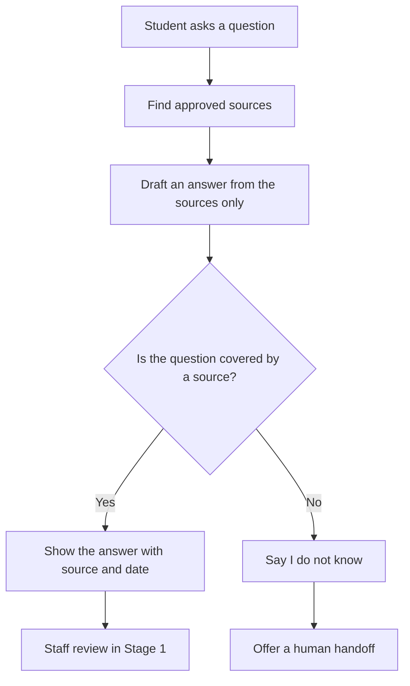
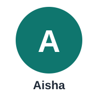

# University Admissions & Student Services Assistant (RAG)

## What this project is

This is an academic AI Product Manager project. It designs — not just demos — a Retrieval-Augmented Generation (RAG) assistant that answers university admissions questions using only approved university documents.

RAG means: the assistant does not answer from memory alone. It first looks up the relevant approved document, then answers from what it finds there, and cites the source and date.

You can run the first version with only a chat tool, the approved documents, and the test sets in this folder — no software build is needed to learn the product decisions here.

## What makes this project unique

No other project in this set can cost a student their place at university with one wrong sentence. That is the angle here: **trust under admissions pressure**. The assistant earns trust not by sounding confident, but by showing its source and date — and by refusing, openly, when no approved source covers the question. Its hardest failure is a confident, wrong deadline or fee. Its key test is the 60-question eval, where the pass bar is ≥92% grounded-correct answers and 100% safe behaviour on the 10 must-refuse questions. Aisha, the example student in the story below, is a first-time applicant who receives three different fee deadlines from three different people — the exact confusion this assistant is built to end.

## The problem

During admissions, a university receives thousands of repetitive questions — deadlines, fees, documents, hostel, scholarships — across email, phone, and walk-ins.

Staff are overloaded. Answers become inconsistent. And a single wrong deadline or fee figure can cause a student to miss admission.

This is a real service and trust problem, not a chatbot demo. A wrong answer here does real harm.

## Why it matters

- **For students:** One clear, correct answer — with a source and a date — instead of conflicting answers from different people.
- **For staff:** Fewer repetitive questions, so staff time goes to the cases that really need a human.
- **For the university:** Fewer errors, fewer complaints, and a record of what was answered and from which document.

## What the assistant does

**In scope:**

- Answer questions only from approved sources: the admission prospectus, fee circular, academic calendar, and scholarship policy.
- Cite the source and date for every answer.
- Offer a human handoff when it cannot answer safely.

**Out of scope:**

- No admission decisions.
- No personal application status.
- No fee payment.
- No guarantee of a scholarship.

**Primary metric:** Resolution rate without staff intervention, with zero critical errors.

A critical error is an answer that is wrong about a deadline, a fee, eligibility, or a required document in a way that could cause a student to miss admission or lose money.

## How it works



The three diagrams in `docs/09-diagrams.md` trace that trust check step by step: ask, find a source, answer with a citation — or refuse and hand over to a human.

## The story



Aisha, a prospective student, gets three different answers about a scholarship fee deadline and is afraid of missing admission. With the assistant, she gets one clear answer with its source and date, so she can trust it — and if there is no source, the assistant says so and offers a human instead of guessing. Read the full story in [docs/10-story.md](docs/10-story.md).

## How to use this project

This project is for learning and portfolio proof. Work through it in order:

1. Read `docs/01-problem-statement.md` — the problem and the evidence.
2. Read `docs/02-research-notes.md` — what students and staff actually need. The interview questions are templates. The findings are marked EXAMPLE until you run real interviews.
3. Read `docs/03-spec.md` — the one-page spec: what is in scope, what is out of scope, and what success looks like.
4. Run the eval in `docs/04-eval.md` and `evals/eval-set.csv` — 60 test questions: 40 typical, 10 hard, 10 must-refuse / must-escalate.
5. Read `docs/05-metrics.md` — how to measure task success, quality, cost per success, and harm.
6. Read `docs/06-cost-latency.md` — the cost and latency estimate, and why simple FAQs go to a cheaper model.
7. Read `docs/07-risks-guardrails.md` — the risks and the guardrails that prevent harm.
8. Read `docs/08-release-portfolio.md` — the staged release plan and the portfolio write-up.

You do not need to build software to complete this. You need to be able to explain the problem, the evidence, the spec, the eval results, the costs, the risks, and the release decision — with documents to prove it.

## Portfolio proof

This folder contains everything a reviewer needs to check the work:

| Proof | File |
|---|---|
| Research summary | `docs/02-research-notes.md` |
| Spec | `docs/03-spec.md` |
| Source inventory | `docs/03-spec.md` and `docs/07-risks-guardrails.md` |
| 60-question eval results with failure analysis | `docs/04-eval.md` and `evals/eval-set.csv` |
| Cost table | `docs/06-cost-latency.md` |
| Rollout decision note | `docs/08-release-portfolio.md` |

The eval results table in `docs/04-eval.md` is blank until you run the eval. Do not fill it in with invented results. The `result` column in `evals/eval-set.csv` is also blank / TBD for the same reason.

## Folder structure

```text
admissions-student-services-assistant/
├── README.md
├── .gitignore
├── docs/
│   ├── 01-problem-statement.md
│   ├── 02-research-notes.md
│   ├── 03-spec.md
│   ├── 04-eval.md
│   ├── 05-metrics.md
│   ├── 06-cost-latency.md
│   ├── 07-risks-guardrails.md
│   ├── 08-release-portfolio.md
│   ├── 09-diagrams.md
│   └── 10-story.md
├── assets/
│   └── avatar-aisha.svg
└── evals/
    └── eval-set.csv
```

## A note on the example data

All questions, interview prompts, and findings in this folder are labelled EXAMPLE or template unless they come from your own real research. They show the shape of good evidence. They are not real student quotes and not real university data.

Replace them with your own anonymised research before you present this as real-world proof.

