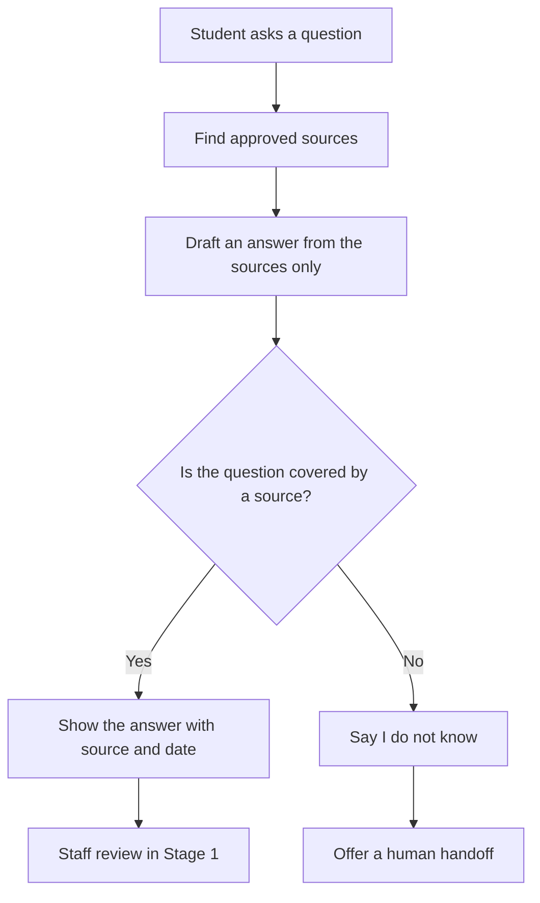
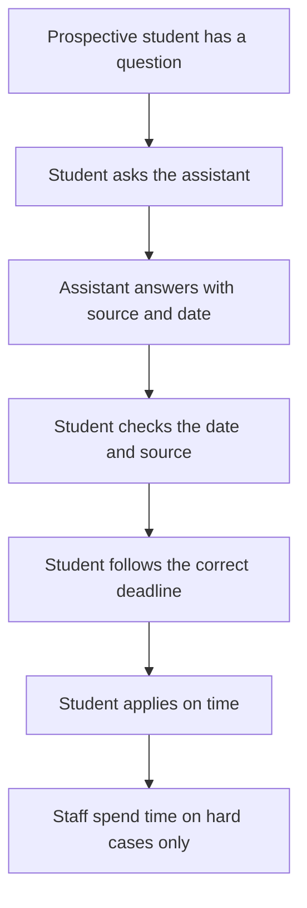
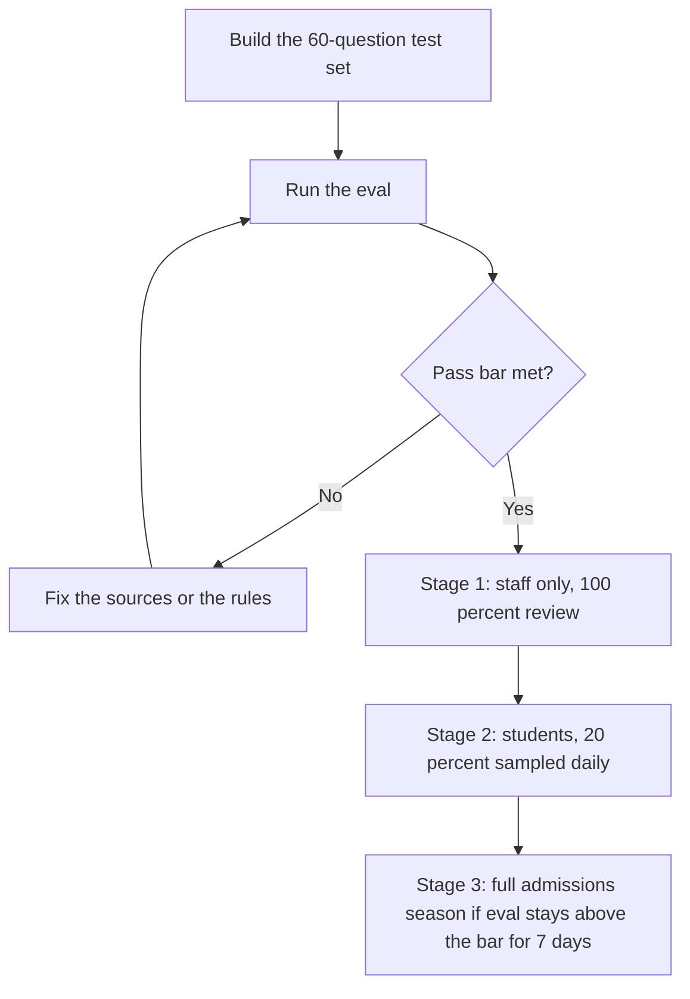

# Diagrams — Admissions & Student Services Assistant

These are simple diagrams to help a beginner see how the product works. They match the spec in `docs/03-spec.md`. No image files are used — the diagrams below are written in Mermaid text, which GitHub renders as a picture.

## 1. How it works

What this shows: the assistant never answers from memory alone. It first finds an approved document, then answers from it. If there is no source, it refuses safely and offers a human.

## 2. User journey

What this shows: before the product, the student got different answers from different people. After it, the student gets one clear answer and can check where it came from.

## 3. Eval and release flow

What this shows: the product is tested before real students use it, and it is released in stages. It only reaches full release if the live eval stays above the pass bar.
