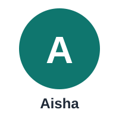

# The story — Admissions & Student Services Assistant

**This is an EXAMPLE fictional story.** It is not a real student, a real quote, or a real result. It shows, in plain language, the problem this project solves.

## Meet Aisha

Aisha is a prospective student applying to university. She is the first person in her family to apply, so she cannot ask anyone at home how it works. She reads the university website, emails the admissions office, and asks at a walk-in help desk. She gets three different answers about the scholarship fee deadline.

One answer says the fee is due on the 10th. Another says the 15th. A third person is not sure. Aisha does not know which answer to trust, and she is afraid of missing her chance.

## Before the product

Aisha keeps checking different places for the same answer. The admissions staff are busy and overloaded, so every reply is short and rushed. Aisha worries that if she trusts the wrong date, she will miss the deadline and lose her place.

This is the real harm in this project: a single wrong deadline or fee figure can cause a student to miss admission.

## After the product

Aisha asks the assistant one question about the scholarship fee deadline. The assistant looks up only the approved documents — the admission prospectus and the fee circular — and answers with the date, the source, and the date that source was last updated.

Aisha can see where the answer came from, so she can trust it. If the assistant cannot find the answer in an approved source, it says so and offers a human handoff instead of guessing.

## What the AI PM learns from this

- A wrong answer is worse than no answer when a deadline is at stake.
- Trust comes from showing the source and the date, not from sounding confident.
- The product must refuse safely when it does not know, and hand over to a human.
- Testing must include the questions where a wrong answer causes the most harm, not just the easy ones.
